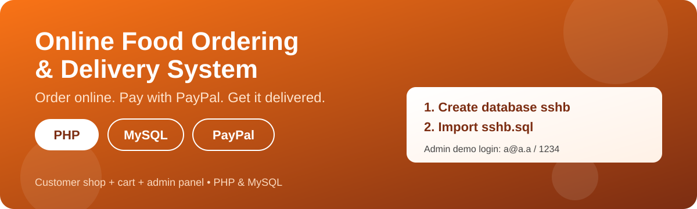
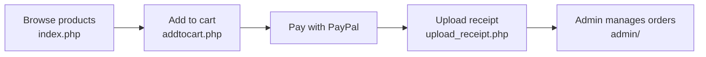

<p align="center">
  
</p>

<p align="center">
  <a href="https://github.com/smabdulmueid97/Online-Food-Ordering-Delivery-System"></a>
  <a href="https://github.com/smabdulmueid97/Online-Food-Ordering-Delivery-System"></a>
  <a href="https://github.com/smabdulmueid97/Online-Food-Ordering-Delivery-System"></a>
  <a href="https://github.com/smabdulmueid97/Online-Food-Ordering-Delivery-System/stargazers"></a>
</p>

<h1 align="center">Online Food Ordering &amp; Delivery System</h1>

<p align="center">
  Order food online, pay with <b>PayPal</b>, and manage it all from an <b>admin panel</b>.<br />
  Plain <b>PHP + MySQL</b> — no framework, no build step.
</p>

<p align="center">
  <a href="#-setup">Setup</a> •
  <a href="#-how-it-flows">How it flows</a> •
  <a href="#-demo-login">Demo login</a> •
  <a href="#-layout">Layout</a>
</p>

---

## How it flows



## 🚀 Setup

Follow the original `readme.txt` exactly:

1. Create a database named **`sshb`** in MySQL.
2. Import **`sshb.sql`** into the `sshb` database.
3. Point the app at that database and open `index.php`.

> `sshb_no_data.sql` is also in the repo — the same schema without the sample data, if you want to start empty.

## 🔑 Demo login

These credentials ship in the repo's `readme.txt` for demo purposes only:

| | |
|---|---|
| Email | `a@a.a` |
| Password | `1234` |

> ⚠️ **Demo-only.** Change them before putting this anywhere public.

## 🗂️ Layout

```
index.php               # shop home
all_product.php         # product listing
single_product.php      # product detail
search_product.php      # search
catagory.php            # categories
addtocart.php           # cart
upload_receipt.php      # payment receipt upload
exist_order.php         # orders
user_login.php          # customer login
user_register.php       # customer registration
userprofile.php         # customer profile
admin/                  # admin panel
Paypal/                 # PayPal integration
assets/                 # static assets
includes/               # shared PHP includes
json/                   # JSON data
sshb.sql                # database + sample data
sshb_no_data.sql        # database schema only
viewfix.sql             # database view fix
```

## License

No `LICENSE` file in this repo yet — add one to set the terms.
